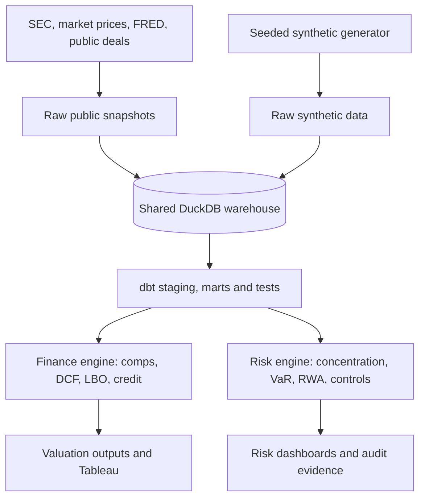

# Deal Screening & Risk Governance Platform

**Phase 0: project foundation.** No financial ingestion or synthetic risk calculations have run.

This portfolio project combines **technology-sector deal screening** (public SEC filings, market prices, FRED and public precedent disclosures) with **synthetic wealth-book risk governance** on one DuckDB warehouse.

## Data boundaries
- **Part A:** Public financial data only. Missing or failed source pulls must be logged, not invented.
- **Part B:** Entirely synthetic advisor, client and position data, seeded for reproducibility. All synthetic tables are prefixed `synthetic_`. Public securities may be referenced for pricing, but positions are fabricated.
- All limits, weights and modelling parameters are illustrative, not employer/client policies. RWA and capital outputs are **not regulatory-compliant**.

## Architecture


Planned namespaces: `raw_public`, `staging_public`, `analytics_public`, `raw_synthetic`, `staging_synthetic`, `analytics_synthetic`, `governance`.

## Windows setup
Install Python 3.11, GitHub Desktop and Cursor, clone the repo, then open PowerShell:

```powershell
py -3.11 -m venv .venv
.\.venv\Scripts\Activate.ps1
python -m pip install --upgrade pip
python -m pip install -r requirements.txt
python -m pytest -q
```

If activation is blocked, invoke `.\.venv\Scripts\python.exe` directly.

## Roadmap
0. Foundation and setup
1. Public ingestion
2. dbt schema and quality
3. Comps, precedents and DCF
4. LBO and credit
5. Synthetic wealth book
6. Concentration and detection proofs
7. VaR, stress, lending and illustrative RWA
8. Anomaly review
9. KRIs, controls, model governance and audit
10. Prefect, CI and Tableau exports
11. Interview case study and documentation

## Risk Governance & Concentration Monitoring
Screenshot checklist (future phases): [ ] KRI scorecard [ ] advisor-sector heatmap [ ] breach watchlist [ ] portfolio drilldown [ ] RWA movement [ ] control/reconciliation dashboard.

**Status:** Only foundation configuration and smoke tests are implemented. No data results are claimed.
