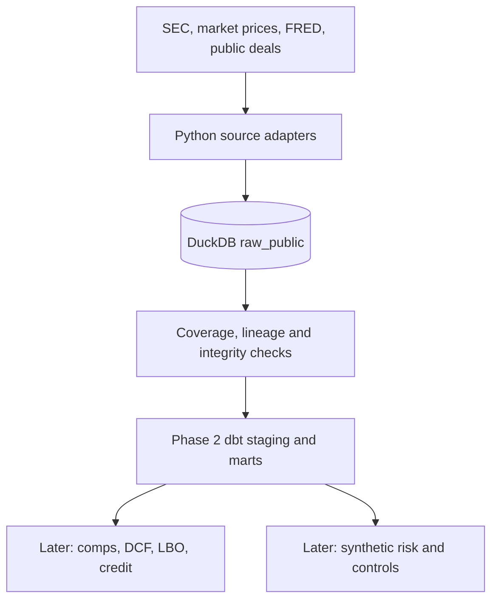

# Deal Screening & Risk Governance Platform

**Phase 1: public-data ingestion implementation, under review.**

This portfolio project combines **technology-sector deal screening** (public SEC filings, market prices, FRED and public precedent disclosures) with **synthetic wealth-book risk governance** on one DuckDB warehouse.

## Data boundaries
- **Part A:** Public financial data only. Missing or failed source pulls must be logged, not invented.
- **Part B:** Entirely synthetic advisor, client and position data, seeded for reproducibility in Phase 5. All synthetic tables are prefixed `synthetic_`. Public securities may be referenced for pricing, but positions are fabricated.
- All limits, weights and modelling parameters are illustrative, not employer/client policies. RWA and capital outputs are **not regulatory-compliant**.

## Architecture


Planned namespaces: `raw_public`, `staging_public`, `analytics_public`, `raw_synthetic`, `staging_synthetic`, `analytics_synthetic`, `governance`.

## Windows setup
Install Python 3.11, GitHub Desktop and Cursor, clone the repo, then in PowerShell:

```powershell
py -3.11 -m venv .venv
.\.venv\Scripts\python.exe -m pip install -r requirements.txt
.\.venv\Scripts\python.exe -m pytest -q
```

If the legacy `py` launcher cannot find 3.11, use `pymanager exec -V:3.11 -m venv .venv`. Activation is optional.

## Phase 1: 40-company technology universe

`config/company_universe.yaml` defines 40 technology tickers spanning software, semiconductors and infrastructure/services. CIKs are resolved from the SEC ticker registry at runtime, never guessed. Tickers that cannot be mapped are logged as failures.

The default CLI is **offline**: it creates the raw DuckDB schema and prints coverage, without network calls:

```powershell
.\.venv\Scripts\python.exe -m ingestion.run_ingestion
```

To opt into public-source ingestion, set a **real SEC contact** in the current terminal (do not commit it):

```powershell
$env:SEC_USER_AGENT = "Your Full Name your.real.email@example.org"
.\.venv\Scripts\python.exe -m ingestion.run_ingestion --live
```

A full live run requests company facts and up to four years of daily prices for 40 companies, plus three FRED series. It may take several minutes and may encounter rate limits. Start with `--max-companies 2` to check connectivity, then use 40. Run results, errors and snapshot checksums are saved in the local DuckDB file, which is gitignored.

To skip a source use `--skip-sec`, `--skip-prices` or `--skip-fred`. The optional public precedent CSV format is documented in `data/reference/README.md`; no transaction values are invented.

**Caveats:** SEC raw XBRL facts are not yet standardized by period or accounting concept. Yahoo data is third-party and not exchange-certified. FRED rates are stored as percentage points. Precedent deals are zero until independently sourced. Live data retrieval has not been confirmed merely by passing offline tests.

## Roadmap
0. Foundation and setup — complete
1. Public ingestion — implementation under review
2. dbt schema and quality — not started
3. Comps, precedents and DCF — not started
4. LBO and credit — not started
5. Synthetic wealth book — not started
6. Concentration and detection proofs — not started
7. VaR, stress, lending and illustrative RWA — not started
8. Anomaly review — not started
9. KRIs, controls, model governance and audit — not started
10. Prefect, CI and Tableau exports — not started
11. Interview case study — not started

## Risk Governance & Concentration Monitoring
Screenshot checklist (future phases): [ ] KRI scorecard [ ] advisor-sector heatmap [ ] breach watchlist [ ] portfolio drilldown [ ] RWA movement [ ] control/reconciliation dashboard.
